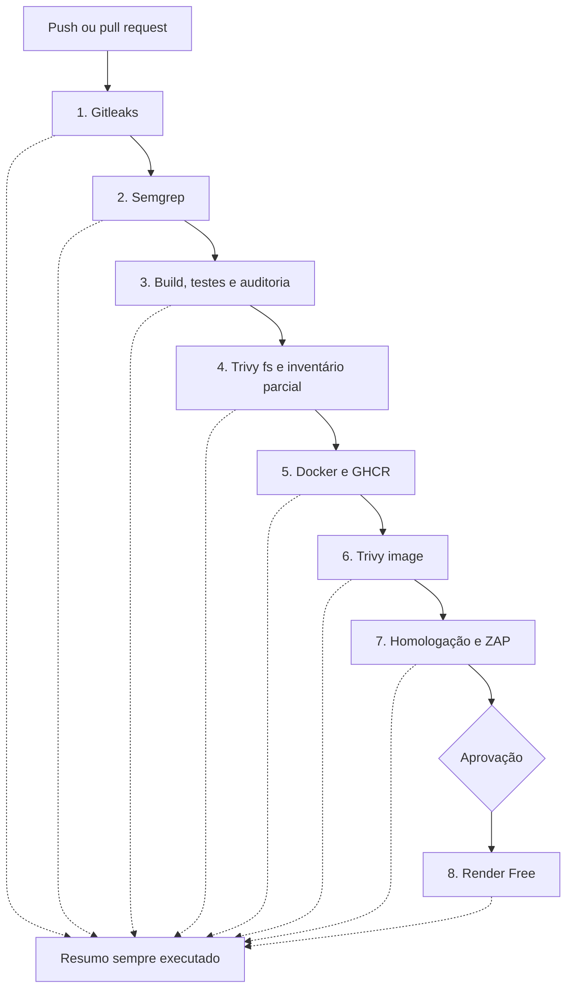
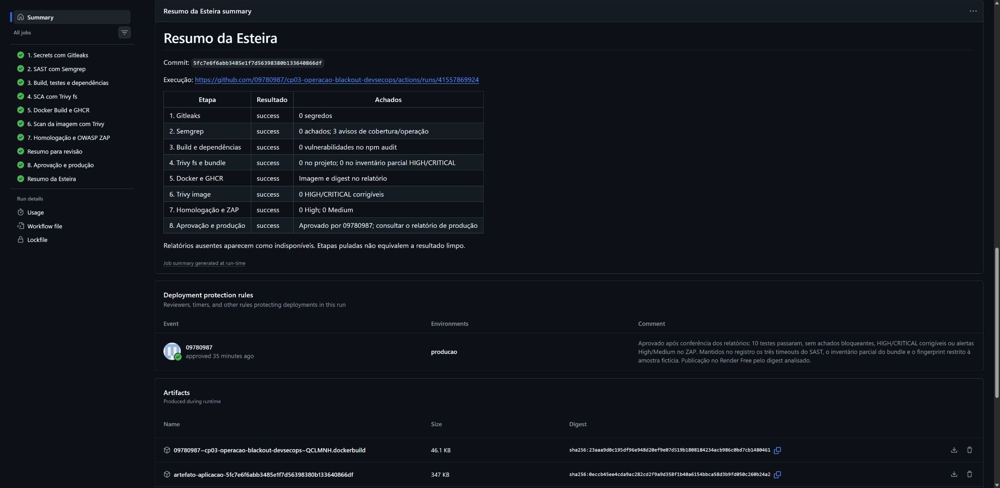

# Operação Blackout - Pipeline DevSecOps


Mateus Kalil - RM565098  
Leonardo Lago Garroti - RM565963

CP 03 de DevSecOps, FIAP, 2026.

Usamos somente o Operação Blackout recebido em `exgame/public_html/blackout`. O jogo da Leroy Merlin Academy apresenta situações de defesa cibernética em cinco cenários. JavaScript, CSS e ícones foram preservados byte a byte; os hashes estão em `config/origem-jogo.json`.

As oito etapas e o resumo terminaram com sucesso na [execução de referência](https://github.com/09780987/cp03-operacao-blackout-devsecops/actions/runs/41557869924). O [teste de bloqueio](https://github.com/09780987/cp03-operacao-blackout-devsecops/actions/runs/41557834346) falhou no Gitleaks como esperado. A correção usa um único fingerprint para a amostra fictícia, gerada apenas para o teste. A regra continua ativa para qualquer outra ocorrência.

Jogo em produção: [https://operacao-blackout-rm565098-rm565963.onrender.com](https://operacao-blackout-rm565098-rm565963.onrender.com). O Render Free pode levar algum tempo para despertar após um período sem acessos.

Commit analisado: `5fc7e6f6abb3485e1f7d56398380b133640866df`.  
Imagem: `ghcr.io/09780987/cp03-operacao-blackout-devsecops:5fc7e6f6abb3485e1f7d56398380b133640866df`.  
Digest promovido: `sha256:f038e8bd6c53cab7bf1e5c3a301ed719af201778bf4f5b719a5fd734a53c2a55`.  
Aprovação: conta `09780987`, registrada no environment `producao`.  
Deploy concluído: `2026-11-03T01:15:37.143349Z`.

## Executar pelo código

Use Node 24.22.2, conforme `.node-version`.

```bash
npm ci
npm test
npm run build
npm start
```

Abra http://localhost:3000. O endpoint `/health` retorna nome, estado e versão gravada na imagem. O jogo também responde em `/blackout/`. O progresso fica no localStorage. O login, o ranking em nuvem, as vozes e o portal PHP não fazem parte deste contêiner.

## Executar com Docker

```bash
docker build -t blackout:local .
docker run --rm --name blackout --read-only --cap-drop ALL --security-opt no-new-privileges:true -p 127.0.0.1:3000:3000 blackout:local
```

Para usar a imagem publicada:

```bash
docker run --rm --read-only --cap-drop ALL --security-opt no-new-privileges:true -p 127.0.0.1:3000:3000 ghcr.io/09780987/cp03-operacao-blackout-devsecops@sha256:f038e8bd6c53cab7bf1e5c3a301ed719af201778bf4f5b719a5fd734a53c2a55
```

O ZIP inclui uma cópia portátil. Carregue com `docker load --input imagens/blackout-imagem.tar.gz` e siga `imagens/COMO_EXECUTAR.txt`.

## Esteira



| Etapa | Objetivo | Relatório da execução completa |
| --- | --- | --- |
| 1. Gitleaks | Histórico completo, valor redigido e bloqueio de secrets | [Artifact](https://github.com/09780987/cp03-operacao-blackout-devsecops/actions/runs/41557869924/artifacts/13194669380) |
| 2. Semgrep | p/default e p/owasp-top-ten; achados bloqueantes | [Artifact](https://github.com/09780987/cp03-operacao-blackout-devsecops/actions/runs/41557869924/artifacts/13195114145) |
| 3. Build e dependências | npm ci, dez testes, npm audit e pacote por SHA | [Artifact](https://github.com/09780987/cp03-operacao-blackout-devsecops/actions/runs/41557869924/artifacts/13195453292) |
| 4. Trivy fs | Vulnerabilidades, configurações e secrets | [Artifact](https://github.com/09780987/cp03-operacao-blackout-devsecops/actions/runs/41557869924/artifacts/13194479988) |
| 5. Docker e GHCR | Build multi-stage e publicação por SHA e digest | [Artifact](https://github.com/09780987/cp03-operacao-blackout-devsecops/actions/runs/41557869924/artifacts/13195560809) |
| 6. Trivy image | Imagem publicada; HIGH/CRITICAL corrigíveis bloqueiam | [Artifact](https://github.com/09780987/cp03-operacao-blackout-devsecops/actions/runs/41557869924/artifacts/13195053958) |
| 7. Homologação e ZAP | Mesmo digest e relatórios HTML, JSON e Markdown | [Artifact](https://github.com/09780987/cp03-operacao-blackout-devsecops/actions/runs/41557869924/artifacts/13195960643) |
| 8. Aprovação e Render | Revisor obrigatório, deploy Free e verificação HTTP | [Artifact](https://github.com/09780987/cp03-operacao-blackout-devsecops/actions/runs/41557869924/artifacts/13195746136) |

[Resumo consolidado](https://github.com/09780987/cp03-operacao-blackout-devsecops/actions/runs/41557869924/artifacts/13195124897). Os relatórios são publicados com `if: always()`. O resumo usa `jq`, depende das oito etapas e distingue resultado limpo, falha, ausência de relatório e etapa pulada. Há também um resumo parcial antes da aprovação. Branches e PRs executam os quatro primeiros controles; as etapas de publicação e deploy são restritas à main.



## Resultados e limites

Os dez testes passaram. Não houve segredos não excepcionados, achados bloqueantes do Semgrep, vulnerabilidades no npm audit, HIGH/CRITICAL bloqueantes no Trivy ou alertas High/Medium no ZAP.

O material recebido é um build pronto do navegador. O build desta entrega empacota esse snapshot e o servidor HTTP; não recompila o projeto React original, que não foi fornecido. O servidor usa módulos nativos do Node. O lock fixa a ferramenta Prettier 3.9.10, usada na preparação do SAST.

O bundle é analisado em uma cópia formatada, com os rulesets exigidos e `p/react`. O original fica intacto. Três timeouts do cliente foram preservados e contados no resumo. O servidor usa `--error --strict`; o cliente usa `--error`, mantendo os avisos visíveis. A cobertura do SCA do bundle é parcial: React 19.2.6, React DOM 19.2.6, Three.js 0.184.0 e React Three Fiber 9.6.1. O fonte e o lockfile originais são necessários para ampliar essa cobertura.

Na comparação anterior, seis ocorrências HIGH estavam no npm da imagem base. Remover npm e Yarn do runtime eliminou essas ocorrências. CSP, proteção contra clickjacking e outros cabeçalhos também foram verificados antes e depois. Os dois alertas Low mantidos pelo ZAP correspondem a dados simulados do jogo e a uma constante do Three.js. A análise está em [observacoes.md](docs/observacoes.md).

## Publicação e privacidade

O environment `producao` exige a conta 09780987 como revisora, aceita somente a main e não permite bypass administrativo. O deploy verifica o histórico da aprovação antes de acessar o Render. A chave fica somente no Environment secret `RENDER_API_KEY`; o repositório contém apenas o nome da variável. Apenas a etapa 5 recebe `packages: write`.

Os nomes e RMs da dupla permanecem públicos por solicitação dos integrantes. O histórico público usa o e-mail protegido do GitHub. Configurações privadas do portal, chaves de nuvem, arquivos de sessão e caminhos pessoais ficaram fora da publicação e do ZIP. Endereços de e-mail que aparecem nas atividades de phishing são conteúdo fictício do jogo recebido.

O repositório usa somente a conta GitHub 09780987 como contribuidora. A identificação acadêmica dos dois integrantes consta neste documento e no PDF.

## Documentos e evidências

- [Pipeline](docs/pipeline.md): configuração das oito etapas e do resumo.
- [Observações](docs/observacoes.md): achados, classificação, ações e lições.
- [Execução](docs/execucao-github.md): SHA, digest, aprovação e produção.
- [Evidências](docs/evidencias/README.md): prints e relatórios preservados.
- [Publicação](docs/publicacao.md): configuração e rollback.
- [Relatório PDF](docs/Relatorio_CP03_DevSecOps_RM565098_RM565963.pdf): texto simples e todos os dez prints das evidências, com legendas.
- [Apresentação](docs/roteiro-apresentacao.md): roteiro de até dez minutos.
- [Licenças](THIRD_PARTY_NOTICES.md) e [referências](docs/referencias.md).

O enunciado fornecido tem 13 páginas e cita um Anexo A ausente. A implementação segue os requisitos escritos nas seções 1 a 9.
